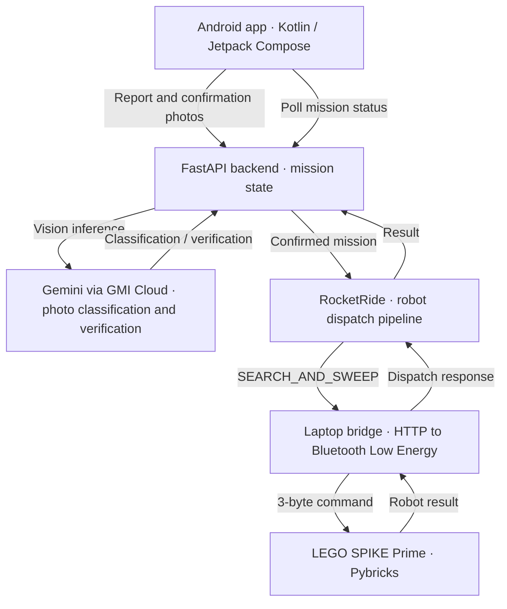

# Trash Patrol — World Cup Edition

**AI-powered litter reporting, robot dispatch, and cleanup verification.**

Trash Patrol connects an Android camera app to a LEGO SPIKE Prime robot. A user photographs litter; Gemini through GMI Cloud classifies the image; a RocketRide pipeline dispatches the robot; and a second photo verifies the cleanup. The app presents mission progress as a soccer match.

🏆 **1st place out of 32 teams** — Google I/O Kickoff: Pre-World Cup Hack, May 23, 2026  
**490/600 points · $2,000 team prize · Team Spike (Tunisia)**  
[Read the published results](https://www.gmicloud.ai/en/blog/what-32-teams-built-for-the-world-cup-in-one-day#:~:text=1st%20Place)

*First-place team photo from GMI Cloud's event recap — click to view the published result.*

## My contribution and team

**[Andrzej Firek](https://github.com/Muifrend) — primary developer.** Implemented the Android app, backend orchestration, LEGO robot bridge, and integration between the components.

**Stephen Kelly and Rafael Sánchez — ideation.** Helped shape the project concept.

The project competed as **Team Spike**, representing Tunisia. The event recap lists the entry under “Spike” and describes the product as “Trash Patrol.”

## How it works

1. **Report:** capture a photo in the Android app, with optional GPS coordinates.
2. **Classify:** the FastAPI backend calls Gemini through GMI Cloud and rejects images that do not confirm trash.
3. **Dispatch:** RocketRide sends a `SEARCH_AND_SWEEP` command to the laptop bridge.
4. **Act:** the bridge sends the command over Bluetooth Low Energy to the Pybricks robot program.
5. **Verify:** after the robot reports completion, the user submits a second photo; the backend asks Gemini whether the trash is gone.

GPS accompanies the report as metadata. The robot uses local ultrasonic sensing; this prototype does not navigate to GPS coordinates. The soccer pitch is a mission-progress visualization.

## Code across three repositories

This repository is the **main project overview and Android app**. The backend and hardware bridge remain separate components with their own setup instructions.

| Component | Repository | Responsibility |
| --- | --- | --- |
| Android app | **[Trash_Patrol](https://github.com/Muifrend/Trash_Patrol)** | Photo capture, optional location, soccer-themed UI, mission polling, confirmation photos |
| Backend | [rocketride](https://github.com/Muifrend/rocketride) | FastAPI API, mission state, direct GMI vision calls, RocketRide dispatch |
| Robot bridge | [LEGO_bridge](https://github.com/Muifrend/LEGO_bridge) | Laptop HTTP API, Bluetooth communication, Pybricks robot program |

## Engineering choices

- **Verify physical work with a second observation:** robot completion leads to a confirmation-photo request; it does not automatically count as a verified cleanup.
- **Separate the interfaces:** the app speaks HTTP, the backend manages missions, and the bridge handles the hardware protocol.
- **Keep mission state visible:** the app polls a mission ID and shows classification, dispatch, and verification progress.
- **Support hardware-independent development:** the bridge has a mock mode for checking HTTP commands without a LEGO hub.

## Try it

The [published event recap](https://www.gmicloud.ai/en/blog/what-32-teams-built-for-the-world-cup-in-one-day#:~:text=1st%20Place) records the winning hackathon build.

To run the components locally:

1. Set up the [LEGO bridge](https://github.com/Muifrend/LEGO_bridge#setup), starting with mock mode or a SPIKE Prime hub.
2. Configure and start the [backend](https://github.com/Muifrend/rocketride#run-locally), including GMI credentials and a RocketRide engine for normal dispatch.
3. Install the [checked-in hackathon debug APK](https://github.com/Muifrend/Trash_Patrol/raw/refs/heads/main/.build-outputs/app-debug.apk), or build the Android app using the [Android development guide](docs/ANDROID.md).
4. In the app's Settings, enter the reachable backend URL and use **Test Connection** before reporting a photo. On a physical phone, use the laptop's LAN address or an active tunnel.

The checked-in APK is a development snapshot, not a maintained release. A historic tunnel URL may still be present in the app; replace it in Settings.

## Prototype scope

This is a hackathon prototype for a controlled robot demonstration.

- Mission state lives in backend memory and resets when the server restarts.
- The robot uses ultrasonic sensing and a fixed search/sweep routine, without mapping or GPS navigation.
- Vision classification and verification depend on the submitted photos and a configured model endpoint.
- The app stops polling after 30 seconds without a state change. Long robot commands may need **Retry Sync**; the bridge also has a 20-second completion wait. See the component guides for these integration limits.
- The backend and bridge are demo services without application-level authentication.

## More detail

- [Hackathon case study](HACKATHON.md)
- [Android setup, screens, and API integration](docs/ANDROID.md)
- [Backend development and API reference](https://github.com/Muifrend/rocketride/blob/main/docs/DEVELOPMENT.md)
- [Robot wiring and command reference](https://github.com/Muifrend/LEGO_bridge#hardware-and-wiring)
